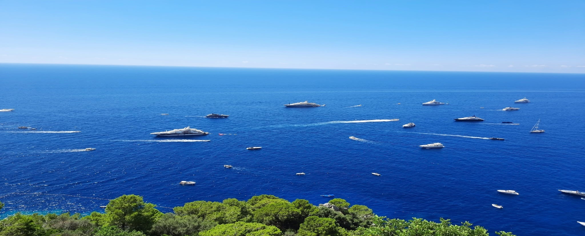



  
  

    <h2><i class="fas fa-book-open"></i> Research output</h2>
    
Papers on extreme value theory, risk assessment, uncertainty quantification and statistical learning, with applications to climate, hydrology, energy and finance.

  

  <small>Capri, Italy</small>

  
<b>19</b>Journal &amp; conference papers

  
<b>3</b>Preprints

  
<b>5</b>Papers in 2026 so far

  
<b>NeurIPS</b>2025, imbalanced classification

<!--

  <h3><i class="fas fa-chart-column" style="color:var(--accent)"></i> Publications per year</h3>
  <svg id="pb-years" viewBox="0 0 600 150" role="img" aria-label="Bar chart of the number of published papers per year from 2019 to 2026"></svg>

-->

<h2 class="pb-h"><i class="fas fa-file-lines"></i> Published articles</h2>

  <button class="pb-chip" aria-pressed="true" data-f="all">All</button>
  <button class="pb-chip" aria-pressed="false" data-f="evt">Extreme value theory</button>
  <button class="pb-chip" aria-pressed="false" data-f="climate">Climate &amp; environment</button>
  <button class="pb-chip" aria-pressed="false" data-f="risk">Risk assessment</button>
  <button class="pb-chip" aria-pressed="false" data-f="learning">Statistical learning</button>
  <button class="pb-chip" aria-pressed="false" data-f="design">Design of experiments</button>
  <button class="pb-chip" aria-pressed="false" data-f="other">Other</button>
  <input class="pb-search" id="pb-q" type="search" placeholder="Search title, journal or co-author" aria-label="Search publications">

Showing all 19 published articles

2026

<ul class="pb-list">
  <li class="pb-item" data-t="climate risk"><h3><a href="https://doi.org/10.1007/s11356-026-38256-z" target="_blank" rel="noopener noreferrer">A novel multivariate vine-copula–based drought index with application to high-elevation catchments</a></h3>
    
Badar, Z., Ahmad, I., <b>Ahmad, T.</b>, &amp; Almanjahie, I. M.

    
Environmental Science and Pollution Research · 33(32), 16359–16379DroughtCopulas
    <button class="pb-btn" data-cite>Cite</button><a class="pb-btn" href="https://doi.org/10.1007/s11356-026-38256-z" target="_blank" rel="noopener noreferrer">DOI</a>
</li>

  <li class="pb-item" data-t="design"><h3><a href="https://doi.org/10.1080/10543406.2026.2680927" target="_blank" rel="noopener noreferrer">Order-of-addition in mixture and component-amount designs in orthogonal blocks</a></h3>
    
Hasan, T., &amp; <b>Ahmad, T.</b>

    
Journal of Biopharmaceutical StatisticsOptimal designs
    <button class="pb-btn" data-cite>Cite</button><a class="pb-btn" href="https://doi.org/10.1080/10543406.2026.2680927" target="_blank" rel="noopener noreferrer">DOI</a>
</li>

  <li class="pb-item" data-t="other"><h3><a href="https://doi.org/10.1080/00949655.2026.2660176" target="_blank" rel="noopener noreferrer">A new composite Mann–Whitney test for two-sample survival comparisons with right-censored data</a></h3>
    
Hussain, A., &amp; <b>Ahmad, T.</b>

    
Journal of Statistical Computation and Simulation · 96(13), 3252–3272Survival analysis
    <button class="pb-btn" data-cite>Cite</button><a class="pb-btn" href="https://doi.org/10.1080/00949655.2026.2660176" target="_blank" rel="noopener noreferrer">DOI</a>
</li>

  <li class="pb-item" data-t="evt climate"><h3><a href="https://doi.org/10.1016/j.ejrh.2026.103330" target="_blank" rel="noopener noreferrer">Regional modeling of zero-inflated precipitation in Pakistan by classical and Bayesian approaches</a></h3>
    
Abbas, A., <b>Ahmad, T.</b>, &amp; Ahmad, I.

    
Journal of Hydrology: Regional Studies · 65, 103330PrecipitationBayesian
    <button class="pb-btn" data-cite>Cite</button><a class="pb-btn" href="https://doi.org/10.1016/j.ejrh.2026.103330" target="_blank" rel="noopener noreferrer">DOI</a>
</li>

  <li class="pb-item" data-t="evt"><h3><a href="https://doi.org/10.1080/02664763.2026.2634785" target="_blank" rel="noopener noreferrer">New flexible versions of the extended generalized Pareto distribution for count data</a></h3>
    
<b>Ahmad, T.</b>, &amp; Arshad, I. A.

    
Journal of Applied StatisticsDiscrete extremes
    <button class="pb-btn" data-cite>Cite</button><a class="pb-btn" href="https://doi.org/10.1080/02664763.2026.2634785" target="_blank" rel="noopener noreferrer">DOI</a>
</li>
</ul>

2025

<ul class="pb-list">
  <li class="pb-item top" data-t="learning"><h3><a href="https://proceedings.neurips.cc/paper_files/paper/2025/file/e715ad3d527e246af3ab286c3f3d367c-Paper-Conference.pdf" target="_blank" rel="noopener noreferrer">Concentration and excess risk bounds for imbalanced classification with synthetic oversampling</a></h3>
    
<b>Ahmad, T.</b>, Kalan, M. M., Portier, F., &amp; Stupfler, G.

    
NeurIPS 2025Imbalanced dataLearning theory
    <button class="pb-btn" data-cite>Cite</button><a class="pb-btn" href="https://proceedings.neurips.cc/paper_files/paper/2025/file/e715ad3d527e246af3ab286c3f3d367c-Paper-Conference.pdf" target="_blank" rel="noopener noreferrer">PDF</a>
</li>

  <li class="pb-item" data-t="evt climate risk"><h3><a href="https://doi.org/10.1002/joc.8705" target="_blank" rel="noopener noreferrer">Estimating extreme drought risk through classical and Bayesian paradigms</a></h3>
    
<b>Ahmad, T.</b>, Sabir, S., Arshad, I. A., Hasan, T., &amp; Albalawi, O.

    
International Journal of Climatology · 45(2), e8705DroughtBayesian MCMC
    <button class="pb-btn" data-cite>Cite</button><a class="pb-btn" href="https://doi.org/10.1002/joc.8705" target="_blank" rel="noopener noreferrer">DOI</a>
</li>

  <li class="pb-item" data-t="evt climate"><h3><a href="https://doi.org/10.1080/03610918.2025.2585398" target="_blank" rel="noopener noreferrer">Modeling zero-inflated precipitation extremes</a></h3>
    
Abbas, A., <b>Ahmad, T.</b>, &amp; Ahmad, I.

    
Communications in Statistics – Simulation and ComputationPrecipitation
    <button class="pb-btn" data-cite>Cite</button><a class="pb-btn" href="https://doi.org/10.1080/03610918.2025.2585398" target="_blank" rel="noopener noreferrer">DOI</a>
</li>

  <li class="pb-item" data-t="design"><h3><a href="https://doi.org/10.1002/pst.70047" target="_blank" rel="noopener noreferrer">Order of addition in mixture-amount experiments</a></h3>
    
Hasan, T., &amp; <b>Ahmad, T.</b>

    
Pharmaceutical Statistics · 24(6), e70047Mixture experiments
    <button class="pb-btn" data-cite>Cite</button><a class="pb-btn" href="https://doi.org/10.1002/pst.70047" target="_blank" rel="noopener noreferrer">DOI</a>
</li>

  <li class="pb-item" data-t="evt risk"><h3><a href="https://doi.org/10.1007/s00181-025-02784-3" target="_blank" rel="noopener noreferrer">Novel modeling for assessment of extreme values risk in cryptocurrencies portfolio</a></h3>
    
Rehman, S. U., <b>Ahmad, T.</b>, &amp; Wu, D.

    
Empirical Economics · 69(4), 2065–2092VaR &amp; ESCopulas
    <button class="pb-btn" data-cite>Cite</button><a class="pb-btn" href="https://doi.org/10.1007/s00181-025-02784-3" target="_blank" rel="noopener noreferrer">DOI</a>
</li>

  <li class="pb-item" data-t="evt"><h3><a href="https://doi.org/10.1177/1471082X241266729" target="_blank" rel="noopener noreferrer">An extended generalized Pareto regression model for count data</a></h3>
    
<b>Ahmad, T.</b>, Gaetan, C., &amp; Naveau, P.

    
Statistical Modelling · 25(5), 416–431Discrete extremesGAMs
    <button class="pb-btn" data-cite>Cite</button><a class="pb-btn" href="https://doi.org/10.1177/1471082X241266729" target="_blank" rel="noopener noreferrer">DOI</a>
</li>
</ul>

2024

<ul class="pb-list">
  <li class="pb-item" data-t="climate risk"><h3><a href="https://doi.org/10.1016/j.heliyon.2024.e25422" target="_blank" rel="noopener noreferrer">A detailed study on quantification and modeling of drought characteristics using different copula families</a></h3>
    
Ahmad, I., <b>Ahmad, T.</b>, Rehman, S. U., Almanjahie, I. M., &amp; Alshahrani, F.

    
Heliyon · 10(3), e25422DroughtCopulas
    <button class="pb-btn" data-cite>Cite</button><a class="pb-btn" href="https://doi.org/10.1016/j.heliyon.2024.e25422" target="_blank" rel="noopener noreferrer">DOI</a>
</li>

  <li class="pb-item" data-t="evt climate"><h3><a href="https://doi.org/10.1016/j.heliyon.2023.e23388" target="_blank" rel="noopener noreferrer">Estimation of regional and at-site quantiles of extreme winds under flood index procedure</a></h3>
    
Ahmad, I., <b>Ahmad, T.</b>, Shahzad, U., Ameer, M. A., Emam, W., Tashkandy, Y., &amp; Badar, Z.

    
Heliyon · 10(1), e23388Extreme winds
    <button class="pb-btn" data-cite>Cite</button><a class="pb-btn" href="https://doi.org/10.1016/j.heliyon.2023.e23388" target="_blank" rel="noopener noreferrer">DOI</a>
</li>
</ul>

2023

<ul class="pb-list">
  <li class="pb-item" data-t="evt climate"><h3><a href="https://doi.org/10.1016/j.egyr.2023.01.093" target="_blank" rel="noopener noreferrer">An efficient Bayesian modelling of extreme winds in the favour of energy generation in Pakistan</a></h3>
    
<b>Ahmad, T.</b>, Ahmad, I., Arshad, I. A., &amp; Almanjahie, I. M.

    
Energy Reports · 9, 2980–2992Extreme windsBayesian
    <button class="pb-btn" data-cite>Cite</button><a class="pb-btn" href="https://doi.org/10.1016/j.egyr.2023.01.093" target="_blank" rel="noopener noreferrer">DOI</a>
</li>
</ul>

2022

<ul class="pb-list">
  <li class="pb-item" data-t="evt climate"><h3><a href="https://doi.org/10.1002/joc.7240" target="_blank" rel="noopener noreferrer">A comprehensive study on the Bayesian modelling of extreme rainfall: A case study from Pakistan</a></h3>
    
<b>Ahmad, T.</b>, Ahmad, I., Arshad, I. A., &amp; Bianco, N.

    
International Journal of Climatology · 42(1), 208–224Extreme rainfallBayesian
    <button class="pb-btn" data-cite>Cite</button><a class="pb-btn" href="https://doi.org/10.1002/joc.7240" target="_blank" rel="noopener noreferrer">DOI</a>
</li>
</ul>

2021

<ul class="pb-list">
  <li class="pb-item" data-t="other"><h3><a href="https://doi.org/10.1155/2021/6289337" target="_blank" rel="noopener noreferrer">Bayesian analysis of cancer data using a 4-component exponential mixture model</a></h3>
    
Noor, F., Masood, S., Sabar, Y., Shah, S., <b>Ahmad, T.</b>, Abdollahi, A., &amp; Sajid, A.

    
Computational and Mathematical Methods in Medicine · 2021, 6289337Bayesian
    <button class="pb-btn" data-cite>Cite</button><a class="pb-btn" href="https://doi.org/10.1155/2021/6289337" target="_blank" rel="noopener noreferrer">DOI</a>
</li>

  <li class="pb-item" data-t="other"><h3>Estimating the determinants of female labor force participation in Pakistan</h3>
    
Cheema, A. R., Firdous, S., &amp; <b>Ahmad, T.</b>

    
International Journal of Disaster Recovery and Business Continuity · 12(1), 413–424Applied statistics
    <button class="pb-btn" data-cite>Cite</button>
</li>

  <li class="pb-item" data-t="other"><h3>Family planning and fertility reduction in Pakistan</h3>
    
Cheema, A. R., Firdous, S., <b>Ahmad, T.</b>, &amp; Imran, M.

    
Ilkogretim Online · 20(5)Applied statistics
    <button class="pb-btn" data-cite>Cite</button>
</li>
</ul>

2019

<ul class="pb-list">
  <li class="pb-item" data-t="evt climate"><h3><a href="https://doi.org/10.15666/aeer/1706_1372913748" target="_blank" rel="noopener noreferrer">Modelling of extreme rainfall in Punjab, Pakistan using Bayesian and frequentist approach</a></h3>
    
Ahmad, I., <b>Ahmad, T.</b>, &amp; Almanjahie, I. M.

    
Applied Ecology and Environmental Research · 17(6), 13729–13748Extreme rainfall
    <button class="pb-btn" data-cite>Cite</button><a class="pb-btn" href="https://doi.org/10.15666/aeer/1706_1372913748" target="_blank" rel="noopener noreferrer">DOI</a>
</li>
</ul>

No articles match this filter.

<h2 class="pb-h"><i class="fas fa-flask"></i> Preprints</h2>
<ul class="pb-list">
  <li class="pb-item" data-t="evt"><h3><a href="https://arxiv.org/abs/2510.27365" target="_blank" rel="noopener noreferrer">Flexible model for varying levels of zeros and outliers in count data</a></h3>
    
<b>Ahmad, T.</b>, et al. (2025)

    
arXiv:2510.27365Discrete extremes
    <a class="pb-btn" href="https://arxiv.org/abs/2510.27365" target="_blank" rel="noopener noreferrer">arXiv</a>
</li>
  <li class="pb-item" data-t="evt climate"><h3><a href="https://doi.org/10.48550/arXiv.2507.15099" target="_blank" rel="noopener noreferrer">Space–time modeling for drought classification and prediction</a></h3>
    
<b>Ahmad, T.</b>, &amp; Hasan, T. (2025)

    
arXiv:2507.15099DroughtEGPD
    <a class="pb-btn" href="https://doi.org/10.48550/arXiv.2507.15099" target="_blank" rel="noopener noreferrer">arXiv</a>
</li>
  <li class="pb-item" data-t="learning"><h3><a href="https://doi.org/10.48550/arXiv.2407.08485" target="_blank" rel="noopener noreferrer">Logistic lasso regression with nearest neighbors for gradient-based dimension reduction</a></h3>
    
<b>Ahmad, T.</b>, Portier, F., &amp; Stupfler, G. (2024)

    
arXiv:2407.08485Dimension reduction
    <a class="pb-btn" href="https://doi.org/10.48550/arXiv.2407.08485" target="_blank" rel="noopener noreferrer">arXiv</a>
</li>
</ul>

  
<b>Always up to date:</b> my complete list with citation counts is on Google Scholar.

  <a href="https://scholar.google.com/citations?user=0Unv8IAAAAAJ&hl=en" target="_blank" rel="noopener noreferrer"><i class="fas fa-graduation-cap"></i> Google Scholar profile</a>

